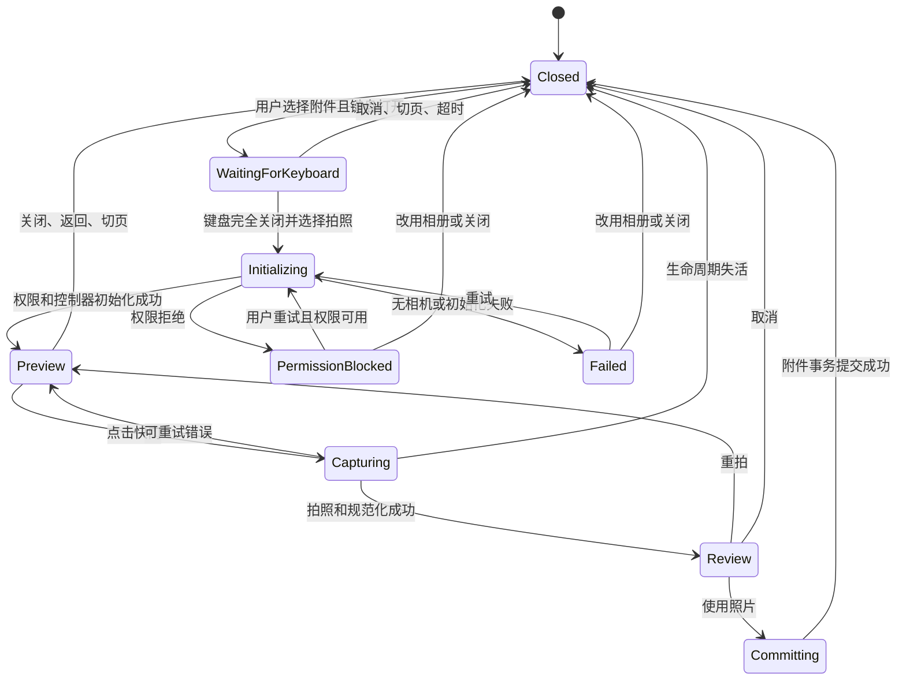

# FitLog Android 内嵌相机、附件事务与页面恢复工程计划

## 0. 文档状态

| 项目 | 内容 |
| --- | --- |
| 状态 | Planned，尚未开始实施 |
| 编写日期 | 2026-07-29 |
| 主要平台 | Android |
| 首要实机 | Samsung Galaxy S24，One UI 8 |
| 涉及页面 | AI Chat、AI 图片食物分析 |
| 计划性质 | 缺陷修复、基础状态治理、相机交互升级 |
| 数据库影响 | 计划不修改 SQLite schema，不提升 `AppDatabase.dbVersion` |
| 后端影响 | 不修改 AI Gateway、Edge Function、模型请求或输出合同 |
| 发布策略 | 先完成恢复基础，再启用内嵌相机；保留可回滚路径 |

本文档是该工程的执行计划、验收清单和风险记录，不代表功能已经完成。完成后的稳定产品行为必须回写到对应的中英文设计文档，发布事实写入 `CHANGELOG.md`。

### 0.1 进度索引

| 阶段 | 内容 | 状态 |
| --- | --- | --- |
| Phase 0 | 基线、可观测性与依赖 spike | Planned |
| Phase 1 | 统一附件事务与恢复快照 | Planned |
| Phase 2 | 首帧恢复和路由修复 | Planned |
| Phase 3 | 共享内嵌相机基础 | Planned |
| Phase 4 | AI Chat 接入 | Planned |
| Phase 5 | AI 图片食物分析接入 | Planned |
| Phase 6 | 相册、遗留兼容、清理与无障碍 | Planned |
| Phase 7 | 全量验证、文档、构建与发布 | Planned |

---

## 1. 执行摘要

本问题不是单一的导航动画缺陷，也不是单一的图片数组覆盖错误。当前 Android 拍照路径通过 `image_picker` 启动系统相机 Activity。FitLog 进入后台后，进程优先级下降；Samsung S24 的 ADB 日志已经两次确认，系统相机运行期间 FitLog 被 `lmkd` 回收。相机结束后 Android 重启 FitLog，现有恢复逻辑再从默认首页切到目标页面，于是用户看到：

```text
系统相机确认照片
→ 黑色启动/重建画面
→ 首页
→ 底部导航从首页跳到 AI
→ 原 AI Chat 或图片分析页面
```

第二张照片替换第一张的现象也与这条进程死亡路径一致。AI Chat 当前只在拍照前保存输入文字、模型选择和一个视觉状态标记，没有保存已经存在的附件，也没有保存本次操作是“追加”还是“替换”。如果第二次拍照期间进程被回收，新进程只能取回第二张照片，第一张未发送附件已经随旧进程消失，因此用户看到的结果是第二张替换第一张。

工程必须同时完成四项基础工作：

1. 建立可持久化、可幂等消费、明确追加/替换语义的附件事务。
2. 让恢复目标在根页面第一次可见之前确定，禁止默认首页成为恢复中间态。
3. 将 Android 的正常“拍照”入口迁移为 FitLog 页面内相机，避免为拍照主动把 FitLog Activity 放入后台。
4. 保留并强化外部相册及遗留系统相机结果的进程死亡恢复，因为外部 picker 仍可能导致 Activity 重建。

内嵌相机降低外部 Activity 引发的进程回收概率，但不能替代状态恢复。附件事务与首帧恢复是基础正确性，内嵌相机是常用路径的体验和稳定性治理。

---

## 2. 已确认的产品决策

以下决策来自本次讨论，后续实现不得静默删减：

1. AI Chat 和 AI 图片食物分析必须分别设计相机交互，不能只复用一个不适配页面结构的弹窗。
2. AI Chat 在键盘弹起时点击附件入口，必须先收起键盘；只有键盘完全退出布局后，才打开图片来源选择或相机面板。
3. AI Chat 的普通“添加图片”永远是追加操作。第二次拍照不得隐式替换第一张。
4. AI 图片食物分析在未启动相机时保持现有大图预览和三个缩略图布局，不增加包住两块区域的新外层卡片。
5. AI 图片食物分析启动相机后，大图预览与三个缩略图共同占用的整块区域切换为相机区域。
6. AI 图片食物分析退出相机后恢复原预览和缩略图布局。
7. 两个页面仍最多接收三张图片，并保留现有 JPEG、PNG、WebP 和单张 4 MiB 上限。
8. 真正的替换必须由明确的替换入口或“已满三张时替换当前选中项”的明确 UI 触发，不能通过恢复逻辑猜测。
9. 图片、输入文字和恢复临时文件只用于当前本地草稿与 AI 请求，不建立长期图片云存储。
10. S24/One UI 8 实机进程死亡场景是发布阻断验收项，不以模拟器测试代替。

这里所说的“小窗相机”是页面内的 `CameraPreview`/CameraX 预览区域，不是 Android 画中画模式，也不是对 ChatGPT iOS 私有实现的复制。

---

## 3. 问题范围

### 3.1 本工程包含

- AI Chat 从拍照入口进入、拍照、确认、追加附件、取消和失败处理。
- AI 图片食物分析从拍照入口进入、拍照、确认、追加或明确替换、取消和失败处理。
- AI Chat 输入文字、provider、已有附件、附件顺序和拍照操作意图的本地恢复。
- 图片分析日期、文字说明、已有附件、选中项和拍照操作意图的本地恢复。
- Android 外部相册 picker 的进程死亡恢复。
- 旧版本遗留 `image_picker.retrieveLostData()` 结果的兼容消费。
- 根 tab 与嵌套页面在冷启动恢复时的首帧目标选择。
- 相机权限、相机初始化、前后台、切 tab、返回键、账号切换和资源释放。
- 图片文件生命周期、内存占用、解码尺寸、压缩和临时文件清理。
- 单元测试、Widget 测试、Android 集成测试、ADB 实机测试、内存验证和回滚。

### 3.2 本工程不包含

- 图片请求完整性、AI 错误删项、Food Draft 内容正确性或 Edge Function prompt 重写。
- 首页“已记录 X 个动作”文案；该问题已独立完成。
- 训练记录保存 mutation、训练草稿通知或训练编辑器恢复；这些已有独立工程。
- AI 模型、订阅、额度、RAG、聊天历史或官方记录写入逻辑的改造。
- 视频拍摄、扫码、滤镜、美颜、连续录像、后台相机或图片流分析。
- 远程图片备份、跨设备未发送附件同步或长期附件云存储。
- 第一阶段的 iOS 发布。页面内相机架构应避免 Android 私有 API 泄漏到业务层，但 iOS 开启前必须另做权限、方向、生命周期和实机验收。

---

## 4. 用户可见问题清单

### 4.1 AI Chat：黑屏、首页闪现、导航跳转

常见触发条件：

- FitLog 在后台停留过一段时间；
- FitLog 进程处于较低优先级；
- App 刚从后台或进程重建状态返回；
- 用户从 AI Chat 启动系统相机并确认照片。

用户可见结果：

- 相机返回后先看到黑色画面；
- 随后看到首页；
- 底部导航高亮从首页移动到 AI；
- 最后回到 AI Chat；
- 输入文字或附件可能恢复，也可能发生附件丢失。

### 4.2 AI Chat：第二张替换第一张

已复现路径：

1. AI Chat 输入框已有第一张图片。
2. FitLog 进入后台一段时间。
3. 回到 FitLog 时仍停留在 AI Chat，第一张图片仍可见。
4. 用户再次拍摄第二张。
5. 第二次系统相机运行期间 FitLog 进程被回收。
6. 新进程只恢复第二张相机结果，第一张未发送图片未被持久化。
7. 页面最终只显示第二张，视觉上等同于“第二张替换第一张”。

这不要求 FitLog 在用户回到页面之前就已经死亡。页面和第一张图仍存在只能证明第二次启动相机之前旧进程仍在；它不能证明外部相机运行期间进程没有随后被杀。

### 4.3 AI 图片食物分析：同类页面恢复风险

图片分析使用相同的外部系统相机和 `retrieveLostData()` 机制。最后一轮实机尝试没有稳定复现黑屏/首页/原页面，但：

- 它与 AI Chat 共享外部 Activity 风险；
- 它也需要根 tab 和嵌套页面恢复；
- 它已有页面级与根级恢复协调器，说明现有架构承认进程死亡场景；
- 间歇性没有复现不能证明问题不存在。

因此图片分析必须纳入同一基础治理，但实机记录必须如实标记为“共享风险，当前轮未稳定复现”，不能伪写成已复现事实。

### 4.4 暖机后不易出现、冷态更易出现

用户观察到：

- App 打开并持续使用一段时间后，问题可能不出现；
- 后台停留较久、进程被系统关闭或处于冷态后，再拍照更容易出现；
- 问题并非每次都能复现。

这与 Android 进程优先级、系统内存水位、相机进程资源需求和 OEM 内存策略有关。它不支持“FitLog 存在一个固定的后台几分钟自动退出设置”这一结论。

---

## 5. S24 ADB 证据

诊断日志保存在本地 `.tmp_adb_logs/`，不作为发布产物。下面只记录可重复核对的事实。

### 5.1 第一轮 AI Chat 相机返回

| 时间 | 事件 |
| --- | --- |
| 01:31:16 | `BEGIN_AI_CHAT_CAMERA_RETURN_TRIAL_1` |
| 01:32:27 | FitLog PID 23308 启动 Samsung 系统相机 `android.media.action.IMAGE_CAPTURE` |
| 01:32:31.280 | `lmkd` 回收 FitLog PID 23308，`oom_score_adj 700`，报告释放约 416476 KiB RSS；原因是 low watermark breached |
| 01:32:31.329 | ActivityManager 确认 FitLog 进程死亡 |
| 01:32:32.883 | Android 为 `ImagePickerFileProvider` 启动新 FitLog 进程 PID 25290 |
| 01:32:33.604 | `MainActivity` 在新进程中重启 |
| 01:33:03 | `END_AI_CHAT_CAMERA_RETURN_TRIAL_1_REPRODUCED_ALL` |

该轮用户确认以下现象全部出现：

- 黑屏；
- 显示首页；
- 导航从首页跳到 AI；
- 最后回到原 AI Chat；
- 原输入文字和图片恢复。

### 5.2 第二张图片测试

| 时间 | 事件 |
| --- | --- |
| 01:51:13 | `BEGIN_AI_CHAT_SECOND_PHOTO_TRIAL_EXISTING_IMAGE_PID_25290` |
| 01:53:01.000 | `lmkd` 回收 FitLog PID 25290，`oom_score_adj 700`，报告释放约 244700 KiB RSS |
| 01:53:01.083 | ActivityManager 确认进程死亡 |
| 01:53:02.438 | Android 为 `ImagePickerFileProvider` 启动新进程 PID 31570 |
| 01:53:58 | `END_AI_CHAT_SECOND_PHOTO_TRIAL_REPLACED_FIRST_BLACK_HOME_AI` |

该轮同时复现：

- 黑屏；
- 首页；
- 回到 AI；
- 第一张被第二张取代。

### 5.3 图片分析测试

| 时间 | 事件 |
| --- | --- |
| 01:56:45 | `BEGIN_PHOTO_ANALYSIS_CAMERA_RETURN_PID_31570` |
| 02:03:46 | 记录一次关闭后台并等待后的新冷态轮次 |
| 02:07:37 | `END_PHOTO_ANALYSIS_ATTEMPTS_NOT_REPRODUCED` |

日志中还存在多次 `remove task` 导致的进程终止，这些来自人工关闭任务，不得与 `lmkd` 证据混为一谈。

### 5.4 证据能够和不能够证明什么

已经证明：

- AI Chat 两次异常都伴随外部相机期间 FitLog 进程被 LMKD 回收。
- 相机返回实际走了新进程和 `MainActivity` 重建，不是普通 Flutter 页面 resume。
- 问题与系统内存水位和进程优先级相关，具有间歇性。

尚未证明：

- FitLog 一定存在 Dart、native 或图片缓存泄漏。
- 所有 Samsung 或所有 Android 设备都会以相同概率触发。
- 图片分析页面在相同条件下一定出现相同可见路径。
- 仅降低 FitLog 内存即可彻底阻止 Android 回收后台进程。

工程应同时减少常用拍照路径的外部 Activity 切换、控制内存，并把进程死亡视为必须正确恢复的合法系统事件。

---

## 6. 现有实现审计

### 6.1 图片选择层

当前文件：`lib/features/food/food_image_picker.dart`

- `FoodImageSource` 只有 `camera` 与 `gallery`。
- Android 相机使用 `ImagePicker.pickImage(ImageSource.camera)`。
- Android 相册启用 `ImagePickerAndroid.useAndroidPhotoPicker = true`。
- 图片请求参数为最大 1600 × 1600、质量 82。
- 多图相册最多返回当前剩余槽位数量。
- `retrieveLostImages()` 使用 `ImagePicker.retrieveLostData()`。
- 返回模型 `PickedFoodImage` 直接在内存中持有全部 `Uint8List`。

Flutter 官方 `image_picker` 文档明确说明：Android 的相机/内容选择通过外部 Intent 运行，源 App 会进入后台并在内存压力下具备被清理资格；恢复必须调用 `retrieveLostData()`。参考：

- <https://pub.dev/packages/image_picker>

### 6.2 AI Chat 恢复快照

当前文件：`lib/features/ai/ai_chat_image_recovery.dart`

当前只保存：

- 输入文字；
- provider；
- 是否保持 ready 视觉。

当前没有保存：

- 已存在图片；
- 图片顺序；
- 当前账号边界；
- 页面/会话身份；
- 操作来源是相机还是相册；
- 操作语义是追加还是替换；
- 操作 ID、创建时间和消费状态。

因此当前快照无法完整恢复“已有第一张，正在添加第二张”的状态。

### 6.3 AI Chat 页面合并行为

当前文件：`lib/features/ai/ai_page.dart`

- `_attachedImages` 只存在于当前 State 内存。
- 正常 picker 返回时使用 `[..._attachedImages, ...nextImages]` 追加。
- 恢复 controller 返回时也对新页面当前 `_attachedImages` 追加。
- 新进程中的 `_attachedImages` 为空，因此只能追加 lost result，无法找回旧附件。
- 恢复版本号只保证 controller 内的一次消费，不构成跨进程幂等事务。
- 达到三张时附件按钮被阻止，不存在明确替换入口。

### 6.4 图片分析恢复快照

当前文件：`lib/features/food/photo_food_analysis_recovery.dart`

当前已经保存：

- 目标日期；
- 文字说明；
- 选中图片索引；
- 已有图片的 app-private 临时文件。

当前不足：

- 没有持久化明确的 `append` / `replace(index)` 操作意图；
- 恢复时通过已有图片是否达到三张推断追加或替换；
- 没有 flow ID、幂等提交 ID、账号边界和过期时间；
- store 与 AI Chat store 语义不一致。

### 6.5 根页面恢复

当前文件：`lib/app.dart`

- `RootTabController` 默认索引固定为 Home `0`。
- `_RootShell` 的 `IndexedStack` 在创建时包含 Home/Food/AI/Workout/Profile。
- 启动后通过 post-frame 回调读取 pending picker 状态。
- AI Chat 恢复再调用 `RootTabController.setIndex(AI)`。
- 图片分析恢复再调用 `setIndex(Food)` 并 `Navigator.push(PhotoFoodAnalysisPage)`。
- 当前实现使用 `deferFirstFrame()` 尝试遮住恢复过程。

2026-07-21 的旧修复已经尝试：

- 将 lost-data 恢复移出根 loading gate；
- 在恢复路由后再允许第一帧；
- 使用深色原生启动背景；
- 保护图片分析页面级恢复不被根级重复 push。

该修复改善了一部分路径，但 S24 实机仍能看到首页与导航切换。这说明“先创建默认 Home，再 post-frame 改索引”的结构没有形成可证明的首帧不变量，或者 native/Flutter 重建期间仍存在可见窗口。

### 6.6 现有测试缺口

已有测试覆盖：

- AI Chat 最多三张图片；
- picker 双卡片布局；
- controller 注入一张 recovered 图片并恢复输入文字；
- 图片分析 lost result 追加已有图片；
- 图片分析已满三张时替换选中图片；
- 图片分析根级和页面级恢复互斥；
- 临时图片不写入 SharedPreferences。

尚缺测试：

- AI Chat “已有第一张 + 进程死亡 + 恢复第二张”；
- AI Chat base attachments 的磁盘快照；
- append/replace 操作意图序列化；
- 同一个 lost result 重复回调只提交一次；
- pending store 写入中断或元数据损坏；
- 账号切换后的跨账号草稿隔离；
- 首个可见 Flutter frame 就是 AI/图片分析，而不是 Home；
- 键盘收起完成后才进入相机；
- 内嵌相机的页面可见性和生命周期释放；
- 相机权限拒绝、永久拒绝、初始化失败、拍照失败；
- 连续打开/关闭的内存稳定性。

---

## 7. 根因模型

### 7.1 主触发：外部系统相机改变进程优先级

```text
FitLog 前台
→ 启动 Samsung Camera Activity
→ FitLog paused/stopped，oom_score_adj 上升
→ Camera 与系统占用更多内存
→ LMKD 在低水位回收 FitLog
→ Camera 完成，FileProvider/Activity 触发 FitLog 新进程
```

这是 Android 允许的生命周期，不应尝试通过后台 service、保活、忽略电池优化或提高进程优先级绕过系统。

### 7.2 首页闪现：恢复目标确定得太晚

```text
新进程启动
→ RootTabController 默认 Home
→ RootShell/IndexedStack 按 Home 创建
→ post-frame 才读取恢复标记
→ setIndex(AI/Food)
→ UI 和导航状态发生一次真实切换
```

即使 `deferFirstFrame()` 理论上可以遮挡一部分绘制，也不能让“默认 Home 从未成为恢复状态”成为架构事实。

### 7.3 图片替换：恢复快照不完整

```text
旧进程：attachments = [第一张]
→ 拍第二张前只保存 text/provider
→ 旧进程死亡
→ 新进程 attachments = []
→ retrieveLostData = [第二张]
→ 页面合并为 [第二张]
```

正常内存路径的 append 写法没有错误；错误发生在跨进程 source of truth 缺失。

### 7.4 间歇性：系统条件不是固定计时器

是否回收取决于：

- FitLog 当时的进程优先级；
- 系统可用内存和 swap 水位；
- Camera 进程的瞬时分配；
- debug/profile/release 构建差异；
- Flutter 引擎、图片解码缓存和 GPU buffer；
- OEM 的后台策略；
- 用户之前打开过的 App。

因此单次“今天没有出现”不能关闭问题，单次模拟器成功也不能作为实机通过。

---

## 8. 目标用户体验

### 8.1 AI Chat

#### 8.1.1 键盘与入口顺序

1. 用户在键盘打开时点击 `+`。
2. 立即对输入框 `unfocus`。
3. 等待 `MediaQuery.viewInsets.bottom` 回到 0，且现有键盘 transition guard 结束。
4. 再显示“拍照 / 相册”来源选择。
5. 不使用固定毫秒延迟作为唯一条件；超时只作为异常兜底。

如果用户在键盘收起过程中再次点击、切 tab 或返回：

- 不重复打开来源选择；
- 取消待打开操作；
- 保留输入文字和已有附件。

#### 8.1.2 相机位置

- 选择“拍照”后，不启动系统 Camera Activity。
- 相机面板固定在 AI 页面内、composer 上方。
- 水平方向与 composer 使用同一最大宽度与左右安全间距。
- 顶部不得遮挡 AI top bar。
- 底部不得与 composer、附件条、底部导航或系统手势区重叠。
- 高度优先使用 4:3 预览；小屏时按 top bar 与 composer 之间可用高度缩放。
- 消息列表的 bottom obstruction 必须把相机面板计入，不能让最后一条消息藏在相机后面。
- 相机打开时键盘保持关闭；用户确认或取消相机后，可主动点击输入框再次打开键盘。

#### 8.1.3 控件

最低必需控件：

- 关闭；
- 拍照；
- 前后镜头切换（设备存在多个镜头时）；
- 闪光灯状态（off/auto，能力不支持时隐藏或禁用）；
- 拍照后“重拍”和“使用照片”。

焦点要求：

- 默认启用平台支持的连续自动对焦；
- 支持时允许点击预览设置 focus/exposure point；
- 自动对焦不可用时不得卡死拍照；
- 需要在 S24 上验证近距离食物和普通距离物体。

用户提供的 ChatGPT 小窗相机讨论中已经出现“新 UI 无自动对焦”的投诉，因此 FitLog 不能把能显示预览视为完成。参考：

- <https://www.reddit.com/r/ChatGPT/comments/1u871on/no_auto_focus_for_the_new_camera_pip_ui_with/>

#### 8.1.4 拍照结果

- 点击快门后立即防重复点击。
- 成功后先在相机区域展示拍摄结果。
- “重拍”删除未确认临时结果并回到预览。
- “使用照片”才把结果提交到附件列表。
- 当已有 0、1、2 张时，结果追加到末尾并成为当前可见的最新缩略图。
- 达到 3 张时不能再进入普通添加相机；显示现有上限提示。
- AI Chat 不通过普通 `+` 隐式替换。用户如需替换，第一版使用“先删除旧图，再添加新图”的明确流程。
- 使用照片后关闭相机面板，保留键盘关闭状态。
- 取消相机不改变已有附件。

#### 8.1.5 返回与导航

- 相机打开时按系统返回键：先关闭相机，不离开 AI 页面。
- 拍后确认态按返回：丢弃未确认结果，回到相机预览；再次返回才关闭相机。
- 切换底部 tab：立即取消相机操作、释放 controller，保留已确认文字和附件。
- 返回 AI tab 时不自动重新打开相机，避免未经用户操作重新访问摄像头。

### 8.2 AI 图片食物分析

#### 8.2.1 未打开相机

保持现状：

- 上方是大图预览；
- 下方是三个缩略图槽；
- 两部分之间保持现有间距；
- 不增加包住大图和缩略图的新外层卡片；
- 当前选中缩略图控制大图；
- 删除、选择和添加行为保持可见。

#### 8.2.2 打开相机

- 选择“拍照”后，大图预览、间距和三个缩略图槽共同占用的整个矩形区域切换为相机面板。
- 该区域外的 provider 选择、文字说明、页面标题和底部分析按钮不重新排版。
- 相机区域尽量保持原组合区域高度，避免页面上下跳动。
- 相机打开时禁止开始分析、切换 provider、编辑图片和打开第二个 picker。
- 文字说明保持已有内容，但键盘必须关闭。

#### 8.2.3 追加与替换

| 当前图片数 | 用户入口 | 操作语义 | 确认后的结果 |
| --- | --- | --- | --- |
| 0 | 大图占位入口 | append | `[新图]`，选中 0 |
| 1 | 大图右下添加入口 | append | `[旧 0, 新 1]`，选中 1 |
| 2 | 大图右下添加入口 | append | `[旧 0, 旧 1, 新 2]`，选中 2 |
| 3 | 明确的“替换当前图片”入口 | replace(selectedIndex) | 只替换选中项，顺序不变 |

已满三张时：

- 来源选择标题必须明确写“替换图片”；
- 进入相机前记录要替换的具体 index；
- 用户在相机期间切换不了目标 index；
- 恢复时不能通过“当前有三张”重新猜测 index。

#### 8.2.4 相机结束

- “使用照片”后恢复原大图和三个缩略图布局。
- 新增图或替换图成为选中图并显示在大图区域。
- “重拍”停留在相机区域。
- 关闭相机恢复原布局且不改变图片。
- 分析按钮仅在相机完全关闭、图片处理完成且现有输入校验通过后恢复可用。

### 8.3 相册

- 相册继续使用 Android Photo Picker/`image_picker`，支持按剩余槽位多选。
- 键盘规则与相机相同：来源选择前先完全收起键盘。
- 相册是外部 Activity，仍必须使用附件事务和 lost-data 恢复。
- 相册返回空列表视为用户取消，不显示错误。
- 选择数量超限、MIME 不支持、单图超过 4 MiB时使用现有用户可读错误。
- 不因迁移内嵌相机而删除 `retrieveLostData()`。

---

## 9. 目标架构

### 9.1 架构组件

建议拆成四个窄职责组件：

1. `EmbeddedCameraController` / `EmbeddedCameraSurface`
   - 只管理相机枚举、权限、preview、focus、flash、镜头切换、拍照和 controller 生命周期。
   - 不知道 AI Chat 或 Food Draft。

2. `PendingImageOperation`
   - 描述一次外部 picker 或内嵌相机操作。
   - 明确 owner、source、append/replace、base attachments 和页面草稿。

3. `ImageDraftRecoveryStore`
   - 保存小型 JSON 元数据和 app-private 临时图片文件。
   - 负责版本、账号隔离、过期、损坏降级和清理。

4. `StartupImageRecoveryCoordinator`
   - 在根 tab 第一次可见之前读取轻量恢复意图。
   - 初始化正确 tab/页面。
   - 调用 `retrieveLostData()` 并幂等提交结果。

业务页面保留自己的 UI state，但不再各自实现互不一致的跨进程协议。

### 9.2 source of truth

| 状态 | 权威来源 |
| --- | --- |
| 页面存活、无外部 picker | 页面内存 draft |
| 即将启动外部 picker | 已持久化的 `PendingImageOperation` 是进程恢复权威 |
| 外部 picker 进程死亡后 | operation 的 base snapshot + `retrieveLostData()` 结果 |
| 内嵌相机预览中 | 页面内存 + 已持久化 base snapshot；未确认 capture 不属于附件 |
| 用户确认照片后 | 先原子写入新 draft snapshot，再更新 UI |
| AI 请求发送中 | 当前请求对象；未发送附件 draft 不再修改 |
| 发送成功或用户显式清除 | 清理附件 draft 和临时文件 |

SharedPreferences 只存小型元数据，不存 base64 或完整图片字节。图片文件保存在 app-private application support/cache 子目录。

### 9.3 操作模型

`PendingImageOperation` 至少包含：

| 字段 | 说明 |
| --- | --- |
| `schemaVersion` | 恢复合同版本 |
| `operationId` | UUID/随机稳定 ID，用于幂等消费 |
| `owner` | `aiChat` 或 `photoFoodAnalysis` |
| `accountId` | 当前账号边界；不得跨账号恢复 |
| `source` | `embeddedCamera`、`externalGallery`、`legacySystemCamera` |
| `mutation` | `append` 或 `replace` |
| `replaceIndex` | 只有 replace 时存在 |
| `createdAtUtc` | 过期和诊断 |
| `status` | `prepared`、`awaitingExternalResult`、`resultReady`、`committed` |
| `baseImages` | 已确认附件的临时文件元数据与稳定顺序 |
| `messageText` | AI Chat 输入文字 |
| `provider` | AI Chat provider |
| `wasReadyVisual` | AI Chat 恢复视觉兼容字段 |
| `sessionId` | 可选；仅在需要绑定当前聊天时使用 |
| `analysisDate` | 图片分析目标日期 |
| `note` | 图片分析说明 |
| `selectedIndex` | 图片分析当前选中项 |
| `resultFingerprint` | 结果文件 hash/大小组合，防止重复提交 |

不要把两个 owner 的所有字段都设为必填。使用 owner-specific payload，外层只共享事务字段。

### 9.4 附件身份

仅使用文件名或字节长度不足以去重。临时附件需要稳定 ID：

- 新捕获/选中时生成 attachment ID；
- recovery snapshot 保留 ID 和顺序；
- result fingerprint 只用于防止同一个 lost result 重复提交；
- 两张内容相同但由用户分别选择的图片仍可作为两个附件，不能仅按内容 hash 全局去重。

### 9.5 磁盘布局

建议：

```text
<application-support>/
  image_draft_recovery/
    <account-scope>/
      <owner>/
        <operation-id>/
          operation.json
          base_0.jpg
          base_1.jpg
          captured_pending.jpg
```

要求：

- 目录位于 app sandbox；
- 文件名不包含用户原始路径、食物名称或聊天文本；
- metadata 写临时文件后 rename，避免半写入 JSON；
- 图片先写完并 flush，再发布 metadata；
- 新 operation 成功发布后再清旧 operation；
- cleanup 失败不得阻止 UI 使用刚捕获的图片；
- 不记录图片字节、base64、完整路径或用户文字到 release log。

### 9.6 过期与账号边界

- pending operation 默认保留不超过 24 小时。
- 同一 owner 新建 operation 时替换旧的未完成 operation，但必须先确认旧 operation 没有正在被消费。
- 账号 ID 不匹配时禁止恢复到页面，清除或隔离旧 operation。
- 退出登录立即清理 AI 未发送图片与 recovery 目录。
- metadata 损坏时，安全清理并打开正常目标页面，不循环重启、不反复弹错误。
- 过期时仍要尽力消费并清理遗留的 `retrieveLostData()`，但不能把过期结果展示给当前用户。

### 9.7 跨进程幂等

同一个 operation/result 必须满足：

- 根恢复与页面恢复竞争时只有一个 owner 获得消费 lease；
- `retrieveLostData()` 最多对一次恢复事务生效；
- repeated resume、rebuild 和 provider notify 不重复追加；
- commit 顺序为“持久化合并后的 snapshot → 发布 UI → 标记/清理 operation”；
- cleanup 前崩溃时，下次根据 committed fingerprint 判断结果已经合并；
- UI 已经显示结果但 cleanup 失败时，不得再次追加。

---

## 10. 首帧与页面恢复设计

### 10.1 不变量

发生进程冷启动且存在有效恢复意图时：

- AI Chat recovery 的根 tab 初始值就是 AI；
- 图片分析 recovery 的根 tab 初始值就是 Food，且第一张 Flutter 内容帧已经包含图片分析页面或专用恢复壳；
- Home 从未成为该次恢复的可见业务状态；
- 底部导航不执行 Home → AI/Food 的动画；
- lost image 读取可以在目标页面内显示 loading，不阻塞到错误首页。

### 10.2 启动顺序

目标顺序：

```text
main / app bootstrap
→ 只读轻量 pending metadata
→ 得到 StartupRecoveryIntent
→ run/build Root providers
→ RootTabController 使用目标 initialIndex
→ RootShell 首次构建目标 tab
→ 目标页面展示恢复 loading
→ 异步读取图片文件与 retrieveLostData
→ 幂等合并
```

不得继续依赖：

```text
RootTabController(initial Home)
→ 首帧后 setIndex(AI)
```

### 10.3 实施选型

实施前做一个小型 spike，在以下方案中选择改动最小且可测的一种：

1. `FitLogApp` 初始化时预读 metadata，并把 `initialRootTab` 与 `initialRecoveryRoute` 注入 providers。
2. 为根 shell 引入轻量 declarative page stack，使图片分析恢复页成为初始 page。
3. 保持 imperative Navigator，但 RootShell 在 recovery intent 未决前只绘制与目标主题一致的恢复壳，绝不绘制 Home；目标 index 在 RootShell 创建前确定。

选择标准：

- 可在 Widget 测试中检查首个可见 frame；
- 不延迟普通冷启动去读取图片字节；
- 不破坏 auth gate、账号 cache hydration、训练保存恢复；
- 不创建第二个根 Navigator；
- 不通过永久全屏 loading 掩盖路由错误。

### 10.4 黑色启动画面的现实边界

如果 Android 已经杀死整个进程，Flutter Engine 和 Dart isolate 必须重新创建，原生 `LaunchTheme`/`NormalTheme` 可能短暂可见。工程承诺：

- 正常内嵌相机路径不离开 FitLog Activity，因此不应发生这类相机返回冷启动；
- 真正冷启动时保持 FitLog 主题一致的原生背景；
- 不显示错误 Home；
- 不显示错误导航动画；
- 目标页面尽快显示可理解的恢复状态。

不能承诺系统杀进程后“绝对零原生启动帧”。

---

## 11. 内嵌相机技术方案

### 11.1 插件选择

首选 Flutter 官方 `camera` 插件及其 Android CameraX 实现，因为它支持：

- 页面内 camera preview；
- 拍照；
- focus/exposure point；
- flash；
- 镜头切换；
- 官方维护的 Android/iOS 平台实现。

参考：

- <https://pub.dev/packages/camera>
- <https://docs.flutter.dev/cookbook/plugins/picture-using-camera>

不得在计划阶段直接把当前最新版号写死到 `pubspec.yaml`。实施 spike 必须检查：

- 当前 Flutter/Dart 版本兼容；
- 当前 `minSdk` 与插件要求；
- target SDK 36；
- CameraX 在 S24 上的 preview、focus、flash、方向和拍照；
- APK 体积变化；
- Android 模拟器与真机差异。

如果最新版要求提高 minSdk，不得静默降低 FitLog 的设备支持。必须选择兼容版本或单独提出 minSdk 产品决策。

### 11.2 相机能力范围

第一版只启用：

- 静态图片；
- `enableAudio: false`；
- rear camera 默认；
- front/rear 切换；
- off/auto flash；
- continuous autofocus 和支持时 tap-to-focus；
- capture orientation 正确；
- 无 image stream；
- 无视频；
- 无后台相机。

### 11.3 相机状态机



每次进入相机生成 `cameraSessionToken`。所有异步 callback 在更新页面前检查：

- widget mounted；
- token 仍是当前 session；
- 页面仍可见；
- app lifecycle 仍允许；
- operation 尚未取消。

过期 callback 只能清理自己的临时文件，不能修改当前附件。

### 11.4 生命周期

Flutter 官方 `camera` 插件不自动替业务处理完整生命周期，页面负责释放和重建 controller。

规则：

- `inactive`、`paused`、`hidden`：停止预览并 dispose controller。
- `resumed`：不自动重新打开相机；如果产品最终选择自动恢复，也必须重新检查页面可见性和用户意图。本计划默认回到 Closed，保留已确认附件。
- 切 root tab：dispose。
- push 新 route 覆盖相机页面：dispose 或暂停；返回时不自动访问相机。
- widget dispose：await/best-effort dispose，不保留 controller 引用。
- 系统权限弹窗导致短暂 inactive 时要区分 permission flow，避免 permission 刚允许就被错误永久关闭；用 session token 串行化。
- 相机被其他 App 占用时展示可恢复错误，不循环初始化。

因为 RootShell 使用 `IndexedStack`，AI tab 切走后 `AiPage` 仍 mounted。相机生命周期必须监听“当前 root tab 是否可见”，不能只依赖 widget `dispose()`。

### 11.5 权限

状态至少包括：

- 未询问；
- 请求中；
- 已授权；
- 本次拒绝；
- 永久拒绝/受限；
- 初始化错误。

行为：

- 第一次进入相机时由官方插件触发/检查 CAMERA 权限。
- 本次拒绝：说明拍照需要权限，保留“重试”和“从相册选择”。
- 永久拒绝：提示用户在系统设置中开启；是否加入“打开设置”按钮由实现 spike 确认最小依赖方案。
- 权限拒绝不得清空输入文字或附件。
- 不申请麦克风权限。
- 无摄像头设备仍允许相册。
- 如相机不是 App 必需硬件，Android manifest 应确认 camera feature 不会把无摄像头设备错误过滤；必要时声明 `android.hardware.camera.any` 为 optional。

### 11.6 图片规范化

内嵌相机返回的原图不能直接无限制读入 UI 和 base64：

- 输出方向必须正确；
- 长边规范化到不超过当前 1600 px 合同；
- 质量以当前 82 为基线；
- 结果 MIME 必须是 JPEG、PNG 或 WebP；
- 单张最终字节不超过 4 MiB；
- 规范化只产生一个业务附件副本；
- 不保留不需要的 image stream frame；
- AI 发送时才生成 base64，发送完成后不长期保留额外编码副本；
- 预览使用 `cacheWidth`/缩略尺寸，避免全分辨率重复解码；
- 规范化失败时保留旧附件并允许重拍；
- 临时原图在规范化成功或取消后清理；
- 不把 GPS、完整 EXIF 或原始文件路径写入日志。若重编码可安全移除非必要元数据，应在 spike 中验证。

---

## 12. 内存治理

### 12.1 为什么必须单独验收

内嵌 CameraX preview 会引入 native camera buffer、Surface/GPU buffer 和 Flutter texture。它避免外部 Activity 把 FitLog 降为后台进程，但如果 controller 或图片副本不释放，仍可能增加内存压力。

### 12.2 构建类型

- debug APK 用于功能和日志，不作为最终内存数字。
- profile 或 release 构建用于 PSS、native heap、graphics 和重复循环。
- 使用项目配置的 Supabase dart-define 构建，不用未配置包替代真实启动结构。

### 12.3 采样点

每轮记录：

1. App 冷启动 Home 稳定后。
2. 进入 AI Chat、无附件。
3. 打开相机 preview。
4. 拍照 review。
5. 使用照片并关闭相机。
6. 三张附件全部存在。
7. 发送/清空附件。
8. 连续打开并取消 3、5、10 次后的 settle 状态。
9. 切后台 2、5、15 分钟后。

工具：

- `adb shell dumpsys meminfo com.fitlog.agent.fitlog_agent`
- Flutter DevTools Memory（Dart heap/retained objects）
- logcat 中 LMKD/ActivityManager
- 必要时 Android Studio profiler 的 native/graphics 视图

### 12.4 内存验收目标

- 不存在随相机打开/关闭次数单调增长的 controller、texture、`Uint8List` 或 decoded image。
- 第 10 次关闭并 settle 后的 total PSS，不高于第 3 次关闭后的稳定值 40 MiB 以上；超过则阻断并定位。
- 相机关闭后 camera controller、preview texture 和未确认原图不可继续被页面引用。
- 最多三张附件时，业务层只保留每张一个规范化字节/文件来源，不同时长期保留原图、压缩图、base64 和多个 decoded full-size 副本。
- 发送后 base64/request 临时对象可以被回收。
- 不调用全局 `imageCache.clear()` 破坏其他页面；只管理本工程拥有的资源。
- S24 连续 10 轮拍照/取消没有 crash、ANR、黑屏或 LMKD 回收 FitLog。

40 MiB 是重复循环的泄漏阈值，不是相机打开时的峰值预算。相机 preview 峰值需在 Phase 0/3 实测并记录，若过高则降低 preview preset、减少 buffer 或调整组件。

---

## 13. 错误与边界行为

| 场景 | 必须行为 |
| --- | --- |
| 用户取消来源选择 | 保持原页面、文字和附件 |
| 用户取消相册 | 无错误提示，不改变附件 |
| 用户关闭相机 | 不改变附件 |
| 相机权限拒绝 | 显示可理解提示，允许重试或相册 |
| 永久拒绝 | 提示系统设置，不循环弹权限 |
| 无后摄 | 可用前摄；无任何相机则只提供相册 |
| 相机被占用 | 释放 controller，提示重试 |
| 初始化超时 | 进入失败态，不留无限 loading |
| 快速双击快门 | 只创建一次 capture |
| capture 完成时已切 tab | 丢弃未确认结果并清临时文件 |
| capture 完成时 widget disposed | 不调用 setState，清临时文件 |
| app 在 review 态进入后台 | 丢弃未确认结果，保留原附件 |
| 相册期间进程死亡 | 从 base snapshot + lost result 恢复 |
| lost result 为空 | 恢复 base snapshot，视为取消 |
| lost result 重复 | 依据 operation/result fingerprint 只合并一次 |
| recovery metadata 损坏 | 清理损坏事务，正常启动，不循环 |
| 临时图片丢失 | 恢复能读取的附件，给出一次轻量提示 |
| 账号切换 | 不恢复旧账号附件，清理旧草稿 |
| 达到三张 | append 入口阻止；图片分析只能明确 replace |
| replace index 越界 | 不猜测，取消 replace 并提示重新选择 |
| 图片格式不支持 | 不改变已有附件 |
| 图片超过 4 MiB | 先规范化；仍超限则拒绝该图片 |
| 方向/旋转变化 | preview 不拉伸，最终图片方向正确 |
| 低电量/省电模式 | 功能可失败降级，但不能丢已有草稿 |

---

## 14. 分阶段实施计划

每一阶段必须在验收通过后再进入下一阶段。内嵌相机 UI 不得先于附件事务基础合入。

### Phase 0：基线、可观测性与依赖 spike

#### 工作

- 保存本次 S24 ADB 时间线和复现步骤到该工程的 QA 记录。
- 在不记录图片内容的前提下增加 debug-only capture flow 日志：
  - process/session start；
  - owner/source/mutation；
  - operationId；
  - lifecycle；
  - root initial destination；
  - lost-data retrieve/commit/cleanup。
- 用 profile/release 包记录当前外部相机前后的 meminfo。
- spike 官方 `camera` 插件：
  - 版本/Flutter/minSdk 兼容；
  - S24 CameraX preview；
  - focus、flash、镜头切换；
  - portrait/landscape；
  - controller dispose；
  - APK 构建。
- 确认图片规范化方案不会引入过大依赖或多份内存副本。

#### 验收

- 可在日志中将一次用户操作串成完整 operation。
- 基线区分 debug 与 profile/release。
- 确定插件版本和 minSdk 决策。
- spike 页面连续开关 10 次没有 controller/texture 明显泄漏。

#### 回滚

- spike 不进入产品入口；删除/隔离实验代码不影响现有 picker。

### Phase 1：统一附件事务与恢复快照

#### 工作

- 新增 versioned `PendingImageOperation`。
- 抽取 app-private 图片快照文件 store。
- AI Chat 在每次启动外部相册/遗留系统相机前保存：
  - 输入文字；
  - provider；
  - 所有已有附件和顺序；
  - append 操作；
  - account scope；
  - operation ID。
- 图片分析扩展现有 store，保存明确 mutation 和 replace index。
- 实现 base + result 的纯函数 reducer。
- 实现 operation/result 幂等消费。
- 兼容读取并清理旧 keys：
  - `fitlog.ai_chat_image.*`
  - `fitlog.photo_food_analysis.*`
- 旧 marker 不能提供的字段使用安全降级，不伪造附件。

#### 必测

- Chat `[A] + recovered B = [A, B]`。
- Chat `[A, B] + recovered C = [A, B, C]`。
- Chat 已满三张时 append 被拒绝。
- Photo append 保序。
- Photo replace 只替换记录的 index。
- 同一 result 两次消费仍只有一份。
- 空 result 保留 base。
- corrupt JSON、缺文件、过期、账号不匹配。
- save/commit/cleanup 任一步失败时不丢 base draft。

#### 验收

- 即使仍使用外部相机，第二张不能再因进程死亡替换第一张。
- recovery store 不向 SharedPreferences 写图片字节。
- 不修改 SQLite schema。

#### 回滚

- 新 store 保留独立 key namespace。
- 旧 loader 在一个版本周期内保留。

### Phase 2：首帧恢复和路由修复

#### 工作

- 在 RootTabController 创建前读取轻量 recovery intent。
- RootTabController 支持显式 initial index。
- AI recovery 初始 index 为 AI，不再运行 Home → AI 切换。
- 图片分析 recovery 初始 index 为 Food，并在首个业务 frame 展示目标恢复页/壳。
- lost image bytes 异步加载，只在目标区域显示 loading。
- 根恢复与 live page recovery 使用同一 single-flight lease。
- 检查与 auth gate、cache hydration、workout recovery 的顺序。

#### 必测

- Widget 首个可见 frame 的 active nav 就是 AI。
- 图片分析首帧不存在 Home 文案/高亮。
- repeated resume 不重复 push 页面。
- 普通无 pending 启动仍从 Home 开始。
- signed-out、account loading、device context 尚未 ready 时不绕过权限和 gate。

#### 验收

- 外部相册或遗留相机导致进程重建时，不显示 Home，不播放 Home → AI/Food 导航动画。
- 真正冷启动只允许主题一致的 native launch surface 和目标恢复 UI。

#### 回滚

- initial destination 逻辑可单独回滚，不删除 Phase 1 的数据完整性修复。

### Phase 3：共享内嵌相机基础

#### 工作

- 加入经过 spike 确认的官方 `camera` 依赖。
- 实现 `EmbeddedCameraSurface` 和 controller adapter。
- 实现权限、初始化、preview、focus、flash、镜头切换、capture、review、retake/use。
- 实现 session token 和 stale callback 保护。
- 实现 app lifecycle、route visibility、root tab visibility 释放。
- 实现图片方向、尺寸、质量和 4 MiB 规范化。
- 建立 fake camera adapter，保证 Widget 测试不依赖真相机。

#### 必测

- 初始化成功/失败/权限拒绝。
- 双击快门只拍一次。
- capture 后 review、retake、use。
- inactive/切 tab/dispose。
- stale callback 不更新新 session。
- preview 尺寸、方向和小屏约束。

#### 验收

- S24 相机 preview、对焦、拍照、前后镜头和 flash 正常。
- app 不启动 `com.sec.android.app.camera`。
- controller 关闭后释放。

#### 回滚

- 组件尚未接入业务入口时可独立移除。

### Phase 4：AI Chat 接入

#### 工作

- 改造 `+` 入口：unfocus → 等待键盘关闭 → 来源选择。
- 相册继续走 Phase 1 external transaction。
- 拍照进入 composer 上方内嵌相机。
- 将相机高度加入消息 viewport obstruction。
- use photo 走 append reducer 和持久化 checkpoint。
- cancel、back、tab switch、account switch 行为按本计划实现。
- 达到三张时禁用 append，不加入隐式 replace。

#### 必测

- 键盘打开时点击 `+`，来源 sheet 在 inset=0 后才出现。
- 相机与键盘从不同时占据 composer 区域。
- 0→1、1→2、2→3 保序追加。
- 已有第一张，background/resume 后第二张仍追加。
- 输入文字、provider、图片和顺序保持。
- 相机打开时消息列表最后一项可见。
- Back 顺序正确。
- 切 tab 释放相机，返回不自动重开。

#### 实机验收

- S24 冷态、暖态、后台 2/5/15 分钟。
- 每个场景至少 10 次拍照。
- 不出现系统相机 Activity。
- 不出现黑屏 → Home → AI。
- 不丢第一张。

#### 回滚

- feature switch 可把 Camera 入口临时切回旧系统相机，但 Phase 1/2 必须保留。

### Phase 5：AI 图片食物分析接入

#### 工作

- 未打开相机时保持现有 `_PhotoPickerPanel` 视觉结构。
- 抽出预览+缩略图组合区域的稳定尺寸。
- camera active 时用相机 surface 替换整个组合区域。
- 0/1/2 张使用 append。
- 3 张时只有明确 replace(selectedIndex)。
- use/cancel/retake 后恢复布局。
- camera active 时禁用分析、provider、图片操作和文字编辑。
- note、date、images、selected index 继续进入恢复 snapshot。

#### 必测

- camera closed 的 golden/geometry 与改造前一致。
- 不出现新增外层卡片。
- camera active 区域覆盖预览+三槽的共同面积。
- append/replace 表中的四种场景。
- replace 目标在相机期间稳定。
- background 后保留原 note/images，未确认 capture 丢弃。
- 完成拍照后分析按钮按现有校验恢复。

#### 实机验收

- S24 空图片、1 张、2 张、3 张。
- 近距离食物自动对焦。
- 关闭/重拍/使用照片。
- 冷态与后台恢复。
- 不出现 Home 中转。

#### 回滚

- 可只关闭图片分析内嵌相机，保留 Chat 与 Phase 1/2。

### Phase 6：相册、遗留兼容、清理与无障碍

#### 工作

- 完成 Photo Picker lost-data 实机验证。
- 消费旧版本 pending marker 和旧相机结果。
- 加入 24 小时 stale cleanup、账号退出 cleanup、启动 orphan cleanup。
- 为相机按钮、关闭、快门、重拍、使用照片、镜头、flash 添加语义标签。
- 检查大字体、TalkBack、横屏/旋转、深浅主题、系统手势区。
- 用户可见新文案全部使用 AppStrings 和 NotoSansSC theme。
- 不记录图片、用户文字或路径到日志。

#### 验收

- 旧版本升级后没有恢复循环或 crash。
- TalkBack 可按正确顺序操作。
- cleanup 失败不阻塞页面。

### Phase 7：全量验证、文档、构建与发布

#### 自动验证

- `dart format lib test integration_test`
- `flutter analyze`
- `flutter test`
- 有新增 integration tests 时运行目标 Android integration suite。
- 配置化 split debug APK：

```text
flutter build apk --debug --split-per-abi --dart-define-from-file=config/supabase.local.json
```

- profile/release memory build按实际签名条件执行。

#### 文档更新

实现完成后按实际行为更新：

- `docs/en/AppGuide.md`
- `docs/zh/AppGuide.md`
- `docs/en/Product.md`
- `docs/zh/Product.md`
- 若临时附件留存/清理边界发生稳定变化：
  - `docs/en/AgentDesign.md`
  - `docs/zh/AgentDesign.md`
  - `docs/en/CloudLocalDataBoundary.md`
  - `docs/zh/CloudLocalDataBoundary.md`
- `CHANGELOG.md`

不需要更新 `Database.md`，除非实施过程中最终选择了 SQLite 持久化；本计划明确优先避免该选择。

稳定设计文档更新后，按仓库规则重新生成本地 Document RAG corpus，完成双语、链接、stale wording 和 embedding parity 检查；在整个文档批次通过前不得上传或激活新 corpus。

#### 发布

1. 内部 S24 APK。
2. 启用 debug-only 操作日志完成验收。
3. 小范围启用内嵌相机。
4. 观察 crash/ANR、权限失败、camera initialization failure 和用户恢复反馈。
5. 默认开启。
6. 保留一个版本周期的 legacy pending loader。

---

## 15. 自动化测试矩阵

### 15.1 reducer / store 单元测试

- append 空列表。
- append 到 1、2 张。
- 第四张被拒绝。
- replace 0、1、2。
- replace 越界失败且不修改 base。
- result 为空。
- duplicate result。
- 相同内容的两次用户选择仍保留两项。
- metadata v1/v2 兼容。
- account mismatch。
- expiry。
- 缺一个 base 文件。
- JSON 截断。
- image write 成功但 metadata publish 失败。
- metadata commit 成功但 cleanup 失败。
- operation 已 committed 后再次恢复。

### 15.2 AI Chat Widget 测试

- 键盘关闭时 `+`。
- 键盘打开时 `+`，先关闭键盘。
- keyboard transition 中重复点击。
- 来源 sheet 取消。
- camera init loading。
- permission denied。
- preview。
- capture/review/retake/use。
- 追加第二张和第三张。
- 第四张阻止。
- 移除后重新添加。
- camera active 时 back。
- camera active 时切 tab。
- capture future 完成时页面 disposed。
- process recovery `[A] + B`。
- recovery 文字/provider/account gate。
- no Home first frame。

### 15.3 图片分析 Widget 测试

- camera closed 布局不变。
- camera active 替换完整组合区域。
- 0→1、1→2、2→3。
- 3 张 replace selected 0/1/2。
- replace 期间 base index 不变化。
- note 键盘先关闭。
- camera active 禁用 submit/provider。
- cancel 保留 note/images。
- background 丢弃未确认 capture。
- lost gallery result 追加/替换。
- root/page recovery single flight。

### 15.4 根启动测试

- no pending → Home。
- AI pending → initial AI。
- Photo pending → initial Food + Photo recovery。
- both legacy markers 异常并存时使用确定优先级并清理另一个。
- signed-out pending 不绕过 auth。
- account loading 后只恢复匹配账号。
- repeated `resumed` 不跳 tab、不重复 push。
- workout recovery 与 image recovery 不叠两个 route。

---

## 16. S24/Android 实机测试矩阵

### 16.1 设备与构建

最低：

- Samsung S24 / One UI 8 / 当前 target SDK。
- Android 模拟器至少覆盖项目最低支持 API 和 target API。
- 如可用，再加一台非 Samsung Android 真机，验证 CameraX 差异。

构建：

- debug：功能与 ADB 标记。
- profile/release：内存与性能。

### 16.2 AI Chat 状态组合

| App 状态 | 输入 | 已有图片 | 操作 |
| --- | --- | --- | --- |
| 刚启动 | 空 | 0 | 拍第一张 |
| 刚启动 | 有文字 | 0 | 拍第一张 |
| 暖态 | 有文字 | 1 | 拍第二张 |
| 暖态 | 有文字 | 2 | 拍第三张 |
| 后台 2 分钟 | 有文字 | 1 | 拍第二张 |
| 后台 5 分钟 | 有文字 | 1 | 拍第二张 |
| 后台 15 分钟 | 有文字 | 1 | 拍第二张 |
| 系统销毁 Activity | 有文字 | 1 | 相册选择第二张 |
| 进程被 `am kill` | 有文字 | 1 | 外部 picker lost result |
| 权限拒绝 | 有文字 | 1 | 打开相机 |

每个关键组合至少重复 10 次；不能用一次成功代表通过。

### 16.3 图片分析状态组合

- 0/1/2/3 张。
- note 空/非空。
- 键盘开/关。
- selected index 0/1/2。
- append/replace。
- 后台 2/5/15 分钟。
- permission deny/permanent deny。
- capture 时锁屏、来电/系统打断、切 App。

### 16.4 进程死亡注入

区分三类测试：

1. “不保留活动”开发者选项：验证 Activity destruction，不等同完整进程死亡。
2. 外部 picker 前台时执行 `adb shell am kill com.fitlog.agent.fitlog_agent`：验证后台进程死亡恢复。
3. 自然 LMKD：保留 ADB 日志，用于验证真实 OEM 行为。

不得用 `force-stop` 代替 lost-result 恢复测试，因为 force-stop 的系统语义与后台回收不同，可能取消 pending intent 或阻止自动重启。

### 16.5 画面验收

- 使用屏幕录制逐帧检查。
- AI Chat 拍照不离开 FitLog Activity。
- external gallery 冷启动恢复的首个 Flutter 业务 frame 不是 Home。
- 底部导航没有 Home → AI/Food 动画。
- 相机面板和键盘没有同时争用底部空间。
- 图片分析 camera closed 布局与旧版对比无额外外层卡片。

---

## 17. 发布阻断验收标准

以下任何一项失败都不能标记工程完成：

### 17.1 数据完整性

- AI Chat 已有第一张时，第二张只能追加，不能替换或丢失第一张。
- 三张附件顺序在普通返回、Activity 重建和进程死亡后一致。
- 输入文字和 provider 恢复一致。
- 图片分析 note、date、selected index 和图片顺序一致。
- replace 只作用于用户明确选择的 index。
- lost result 重复回调不重复追加。

### 17.2 页面连续性

- 正常拍照不启动系统 Camera Activity。
- 正常拍照没有黑屏、首页和导航跳转。
- external gallery/遗留 result 冷启动恢复不显示 Home 中间态。
- 目标页恢复 loading 不阻塞账号/订阅/device gate。

### 17.3 相机体验

- 键盘完全关闭后才显示来源选择/相机。
- preview 无拉伸、无错误旋转。
- S24 近距离食物可以自动或点击对焦。
- 快门、重拍、使用、关闭、镜头和 flash 正常。
- Back、切 tab、前后台行为符合本文。

### 17.4 稳定性与内存

- `flutter analyze` 无问题。
- `flutter test` 全部通过。
- 配置化 split APK 构建通过。
- S24 连续 10 次没有 crash、ANR 或相机黑屏。
- 内存循环满足第 12 节阈值。
- controller、texture、未确认原图和 base64 无可见泄漏。

### 17.5 隐私与清理

- 图片只在 app-private 临时目录。
- release log 不含文字、图片、base64、路径。
- 发送/清除/退出账号/过期后清理。
- cleanup 失败不阻止用户继续使用。
- 不新增未批准的图片云同步。

---

## 18. 风险与缓解

| 风险 | 后果 | 缓解 |
| --- | --- | --- |
| 最新 camera 插件提高 minSdk | 老设备无法安装 | Phase 0 先核对，禁止静默提高 minSdk |
| CameraX 在 Samsung 对焦异常 | 小窗能看但拍糊 | continuous focus、tap focus、S24 近距离验收 |
| preview native/GPU buffer 增大内存 | 新方案反而增加压力 | 关闭 image stream/audio、控制 preset、严格 dispose、profile PSS |
| IndexedStack 隐藏页面仍 mounted | 切 tab 后摄像头继续占用 | 显式监听 root tab visibility |
| permission dialog 触发生命周期竞态 | 刚授权就关闭或重复初始化 | session token + permission flow 状态 |
| capture callback 晚到 | 已离页仍追加图片 | token、mounted、visibility 三重检查 |
| 大图多份副本 | Dart heap/PSS 上升 | file-backed snapshot、一次规范化、按需 base64、cacheWidth |
| 启动预读拖慢普通启动 | 所有人看到 loading | 只读小 metadata，不读图片字节 |
| 根恢复与页面恢复竞争 | 重复 push/重复图片 | single-flight lease + operationId |
| 老版本 pending keys | 升级后 crash/循环 | legacy loader + 有界兼容期 |
| 账号切换 | 上个账号图片泄漏 | account scope + sign-out cleanup |
| fallback 静默启动系统相机 | 原问题回归 | 正常失败只提供重试/相册；系统相机 fallback 不默认 |
| 模拟器行为正常 | 真机仍失败 | S24 是发布阻断设备 |
| debug 内存误导 | 错判泄漏或稳定性 | profile/release 才做最终数字 |
| 图片分析未复现 | 工程被误认为无必要 | 按共享架构风险治理，同时如实记录证据 |
| 计划只修 UI | process death 仍丢附件 | Phase 1/2 必须先于内嵌相机 |

---

## 19. 回滚方案

回滚必须分层，不能为了关闭相机 UI 一并撤销数据完整性修复。

### 19.1 可独立保留

即使内嵌相机需要暂时关闭，也必须保留：

- 完整附件 snapshot；
- append/replace 操作语义；
- operation 幂等；
- initial destination/无 Home 中转；
- external gallery lost-data 恢复；
- legacy key cleanup。

### 19.2 内嵌相机开关

在产品启用阶段提供本地构建配置或受控 feature switch：

- 开：Camera 按钮进入内嵌相机。
- 关：临时回到旧系统相机，但仍走 Phase 1/2 的完整事务恢复。

开关不能依赖新的云端配置平台，也不能改变图片权限/隐私边界。

### 19.3 数据兼容

- 新版本读取 v2，再读取 legacy。
- 回滚旧版本时 v2 key 被忽略，不得覆盖现有正式记录。
- v2 临时目录由新版本 cleanup；即使回滚遗留，也只能占用 app-private 临时空间。
- 无 SQLite migration，因此不存在数据库 downgrade。

---

## 20. 预计代码影响面

可能新增：

- `lib/features/media/embedded_camera_controller.dart`
- `lib/features/media/embedded_camera_surface.dart`
- `lib/features/media/image_attachment_draft.dart`
- `lib/features/media/image_draft_recovery_store.dart`
- `lib/features/media/startup_image_recovery.dart`
- 对应 `test/` 与 `integration_test/` 文件

预计修改：

- `pubspec.yaml`
- `pubspec.lock`
- `android/app/src/main/AndroidManifest.xml`
- `lib/main.dart` 或 `lib/app.dart` 的轻量 startup recovery 注入
- `lib/features/ai/ai_page.dart`
- `lib/features/ai/ai_chat_image_recovery.dart`（迁移/兼容后可收敛）
- `lib/features/food/food_image_picker.dart`
- `lib/features/food/photo_food_analysis_page.dart`
- `lib/features/food/photo_food_analysis_recovery.dart`
- `lib/core/localization/app_strings.dart`
- 现有 AI/图片分析/root navigation 测试

实施时以最小可验证改动为准，不要求为了匹配上述建议文件名做无关重构。

---

## 21. 完成定义

只有同时满足以下条件，计划才能从 Planned 改为 Complete：

1. Phase 0–7 的工作和验收均有实际证据。
2. AI Chat 的 S24 两个已复现问题均无法在规定矩阵中复现。
3. 图片分析完成相同基础恢复和内嵌相机验收。
4. external gallery 的进程死亡恢复仍正确。
5. 首个可见业务 frame 不经过 Home。
6. 附件 append/replace 是显式、幂等、可测试的事务。
7. 相机生命周期和内存循环通过。
8. 所有自动测试、静态分析和配置化 APK 构建通过。
9. 中英文稳定设计文档、CHANGELOG 和本地 RAG corpus 按实际实现同步。
10. 回滚开关和 legacy compatibility 已验证。
11. 计划中的未完成项、例外或阈值变更均被明确记录并获得批准，不能通过删除验收项宣称完成。

---

## 22. 实施前最终检查

- [ ] 用户确认本计划的内嵌相机交互。
- [ ] camera 插件/minSdk spike 完成。
- [ ] S24 profile/release 基线采集完成。
- [ ] Phase 1 测试先写，能复现第二张覆盖第一张。
- [ ] Phase 2 首帧测试先写，能证明 Home 中转。
- [ ] attachment source of truth 和 cleanup 顺序通过代码评审。
- [ ] 无 backend、SQLite、云图片同步的隐式扩张。
- [ ] 逐阶段提交，恢复基础与 UI 可独立回滚。
