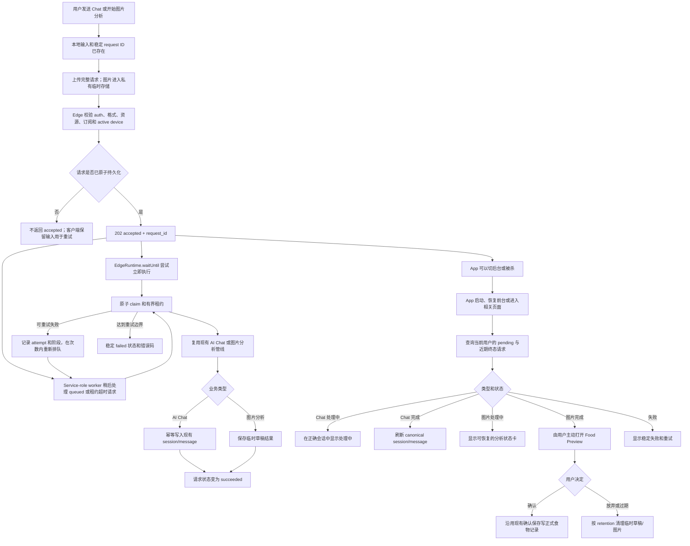

# Agent 设计

## 目标

本文定义 FitLog_Agent V1 的产品层 AI/Agent 边界：有哪些能力、从哪里进入、允许使用什么数据、可以返回什么，以及哪些动作始终由用户控制。

模型 output schema、校验、纠错和失败语义属于 [AIOutputContract.md](AIOutputContract.md)。Context object、retrieval、ingestion、evidence 和 RAG 安全属于 [RAGDesign.md](RAGDesign.md)。精确产品交互和视觉理由属于 [Product.md](Product.md)。

长期规则是：

```text
AI 可以生成草稿、解释规则、检索有界上下文、追问缺失信息。
AI 不能静默写入正式记录、修改目标或策略、删除数据。
```

FitLog 的确定性记录、饮食、训练、摘要和导出系统继续拥有权威。Agent 层只在这些系统外增加账号 gated 的远程 AI、typed drafts、受限检索和用户可见 evidence；它不会把模型变成数据库操作者或 autonomous coach。

## 运行模型

FitLog 不在设备端运行模型。远程调用统一通过使用服务端 provider credentials 的 Supabase Edge Functions。

```text
用户请求
  -> auth、subscription 和 active-device 校验
  -> 恢复并消费匹配的 pending clarification
  -> 明确入口与确定性 safety rules
  -> 唯一 approved Chat Decision 与服务端 Context Policy
  -> 允许的同会话 / 动作 / Structured RAG / Document RAG context
  -> 已配置 provider call（当前发布为 Qwen）
  -> 共享 output 校验与归一化
  -> 合法 answer、可选 typed draft 与 evidence
  -> 任何正式写入前由用户 review
```

每条 AI 路径分离四层职责。Surface orchestration 负责入口、目标语言、本地 provider preference、允许的终态和 UI 确认；版本化 Capability Core 负责任务、Food/Workout 草稿边界和 Context 需要；OpenAI/Qwen adapter 只把同一能力编码为 provider-specific 文字、图片、schema 和 tool protocol，不能重新定义产品规则；Shared validation 强制执行结构、日期、数值、grounding、安全和确认边界。更换 provider 不能扩大 Context、绕过校验或写正式数据。

## 可靠 AI 交付

对普通 AI Chat turn 和 Add Food 图片分析而言，“用户回来能看到结果”表示 Edge Function 返回 `202 accepted` 之后，请求生命周期由云端接管，不再依赖 Flutter 页面、前台状态或进程是否存活。用户之后回来必须看到三种可恢复状态之一：仍在处理中、已成功并可使用既有业务结果、已失败并提供稳定重试动作。Provider 长时间不可用仍可能导致无法生成合法答案，但已经 accepted 的请求不能消失，也不能永久转圈。



共享交付层保持很窄：request 归属、`kind`、`queued`/`running`/`succeeded`/`failed`、原子 claim、租约过期、attempt 上限、稳定错误码、时间戳、隐私安全观测、幂等和短期 retention。它不理解 Chat 答案、Food Draft 字段、provider prompt、RAG 内容或正式记录。

AI Chat 交付继续把 `ai_chat_sessions` 和 `ai_chat_messages` 作为唯一聊天历史。Accepted 路径在返回前持久化或校验目标 session；worker 使用 request/client 幂等键记录 assistant turn，使重复 worker 不会创建重复可见消息。图片交付必须在 accepted 前把请求图片放进私有临时 bucket，把既有 Food Draft response envelope 保存为临时结果，并且在用户打开 Food Preview 并通过现有 editor 保存前，绝不写入 `food_records`。

`chat_decision.v2` 是普通 Chat 唯一 active decision contract。它按固定优先级消费合法 clarification reply，应用 safety 与 fixed-entry constraints，接受少量中英对称的高置信结构规则，其余开放语义只进入一次有界 planner。输出共同固定 capability、允许/选中的 output family、授权 Context 请求、clarification 状态和附件策略。旧 decision 生产分支及其 runtime flags 已退场；对应 comparator 只保留在确定性的历史行为等价测试中，不能影响生产结果。Planner failure 是系统故障，不是用户歧义的证据。

该运行层包含：

- 云端账号、subscription、Cloud Profile、Cloud Records 和 daily summaries；
- 位于底部导航中间的全屏 AI Chat；
- 不需要用户提供 API key 的当前发布 Qwen 文字/图片路由，以及为未来合法配置发布保留的 OpenAI adapters；
- 最多三张图片的 Qwen AI Chat multimodal 请求，以及专用 Add Food 的 Qwen 图片请求；
- 云端 chat history 和有界同会话连续性；
- 基于最小必要 summary 的 Structured RAG；
- 基于稳定双语 FitLog 文档的 Document RAG；
- 经过 schema 校验的 Food Draft 与 Workout Draft artifact；
- 正式写入前的明确 review 和普通 editor save。

该运行层不包含：

- 用户自填 provider key；
- 开放式 tool calling 或 Agent loop；
- 多 Agent 系统；
- 任意数据库访问或模型生成 SQL；
- 用完整历史上传代替 context builder；
- 用户业务数据 embedding、vector database、GraphRAG 或长期 semantic memory；
- 静默修改目标、策略、记录或删除数据；
- 医疗诊断或治疗建议。

## 能力分类

AI 相关兼容能力与 Agent workflow 必须保持可区分：

| 能力 | 行为 | 分类 |
| --- | --- | --- |
| Prompt template copy | 唯一入口位于 Paste AI Result。它建立可复用的外部食物估算对话约束：每个新的外部 chat 只发送一次，之后直接提交图片、描述和修正，并把完整 JSON 粘贴回 App。最高优先级规则要求最终回复只有一个 JSON 对象，并要求模型先完成准备输出的 items，再以这些 items 生成所有顶层总计。模板遵循与应用内 Food Draft 相同的证据原则：文字通常只补充图片的一部分，作用范围清楚的用户事实只在对应食物和字段上覆盖估算。卡片推荐 ChatGPT 中的“FitLog 中文助手”与“FitLog Estimator”。回复保留既有完整扁平 JSON schema；字段名保持英文，自然语言值跟随用户当前使用的主要语言。尾部 `estimation_notes` 通常为空，只允许必要且不重复的补充信息。复制的 Prompt 语言跟随 App 语言。 | 用户中介的外部 AI，不是 App 内部 AI，也不是 Edge prompt。 |
| 外部 AI JSON 粘贴 | 用户粘贴外部生成的食物 JSON，FitLog 使用既有食物估算 schema 在本地解析。 | 用户中介的外部 AI，不是 App 内部 AI。 |
| `source = ai_paste` | 标记兼容流程确认后的 food record 来源。 | 只表示 provenance，不证明发生内部模型调用。 |
| Add Food AI 分析 | 把文字和零到三张图片发送给 `ai-food-photo-analyze`；入口固定 Food Draft family，校验后在同步兼容路径直接打开 Food Preview，或返回 accepted delivery row，由完成状态卡在用户点击后打开 Food Preview。 | 服务端中介的确定性 draft workflow，不重新判断 Chat 意图。 |
| AI Chat | 所有 gates 通过后，通过 Qwen 发送文字和最多三张图片。选择未配置的 ChatGPT 时显示短暂 unavailable error 且不发送 request；Gateway 先处理高置信度意图，无法确定时由已配置模型在受限 output types 中选择。 | 服务端中介的 answer 或 draft generation。 |
| Structured RAG | 为 routed read-only workflow 构建 typed、最小必要服务端 context。 | 服务端中介的只读 context。 |
| Document RAG | 为 App 逻辑问题检索稳定双语设计 corpus。 | 服务端中介的只读 evidence。 |
| 用户记录摘要权限 | 控制受保护 record summary 是否可以进入 routed AI context。 | 权限控制，不是 AI 输出。 |

Chat persistence、request logs、debug summaries、Gateway transport models 和 evidence snapshots 都是支撑基础设施。它们的存在不会授予模型额外读写权限。

Add Food 与 AI Chat 继续使用不同 Edge Function、完整 prompt 和 response envelope，但食物生成 adapters 共用一套证据 policy，全部 adapters 也使用一条小型目标语言指令。证据 policy 不会把用户文字误当成完整清单：它保留作用范围清楚的明确事实，让图片补充文字未提到的食物和缺失字段，并把冲突留在可编辑草稿中供用户确认。语言指令让用户可见自然语言跟随请求语言，同时保留固定字段名、单位、品牌、包装原名和必要专有名词。Edge 的运行时校验继续只负责结构和确定性不变量；无论食物范围判断还是回复语言，都不能重新成为 regex blocker。

## 入口

主要 Agent 入口是中间 AI tab：

```text
Home | Food | AI | Workout | Profile
```

AI 页面是全屏对话，不是 quick-chip 工作台。除了 Add Food AI 分析，其它 Agent workflow 都从该页面开始。

| 入口 | 用途 | 边界 |
| --- | --- | --- |
| AI Chat | 饮食/训练草稿、用餐决策、周复盘和 App 逻辑问答。 | 发送需要登录、联网、有效订阅、active device、Cloud Profile 和已配置 Gateway/provider。 |
| Add Food AI 分析 | Food 创建流程内的文字或图片食物估算。 | 只产生可编辑 Food Draft；保存必须确认。 |
| 外部 JSON 粘贴 | 外部生成 food JSON 的兼容路径。 | 用户控制的本地解析，不是 Agent call。 |

## AI Surface 契约

AI 页面必须让用户看见能力和权限边界，但不暴露 provider internals：

- 发送不可用时 composer 仍可编辑，但所有运行期 gate 通过前 send action 保持禁用。
- 可用的 Qwen 选择保存在设备本地；具体模型和 provider credentials 留在服务端。不可用的 ChatGPT 选择只在短暂点击反馈期间进入当前 UI 状态，随后选择器自动滑回 Qwen，不会持久化为 active provider。
- 支持最多三张 JPEG、PNG 或 WebP attachments；当前请求通过 Qwen 路由。在 AI Chat 或 Add Food AI 分析中选择未配置 ChatGPT 时，显示正常生命周期的“当前模型不可用”错误，保留输入，不发送 provider request，并以共享滑动选择器恢复 Qwen 选中态。该 UI 恢复不是 provider fallback，不会把原点击转换为 Qwen request；状态 pill 继续只反映订阅、设备和 Gateway readiness。
- 小型本地 picker-recovery marker 可以在 Android activity 重建后恢复 composer text、provider、attachments 或 Add Food analysis。恢复不能排队/自动发送，也不能绕过真实账号或 Gateway readiness。
- 意图澄清使用可持久化的 `ai_chat_clarification.v2` object，包含 opaque ID 与 allowlisted options。客户端以稳定 request ID 发送 typed option reply；服务端在任何新意图推断前幂等 claim 并消费。业务缺字段最多再追问一轮；重复的 no-progress signature 必须进入稳定错误。
- 请求清晰时当前图片必须在同一 turn 使用。当清晰用户文字已经足以完成选中的回答或草稿时，图片不清晰不能重新触发 intent selection；不确定性应保留在结果中。Clarification 只能保留 account/session scoped 的 runtime attachment lease；数据库、history、logs 和 RAG corpus 都不保存像素。历史重载、进程重启、清空本地数据、退出或切换账号会让 lease 失效，并把可见状态改为需要重新附图。
- 未发送 composer text 在当前运行期跨 tab 和临时禁用状态保留。Send start 把它清入 pending turn，失败再恢复；退出或切换账号清除。
- 云端 history 支持新建、切换 session、行内重命名和确认删除；没有恢复 UI 时不暴露 archive。
- Assistant text 使用维护中的 Markdown renderer 和可选中文本，不加载远程图片，也不执行 link action。
- Food Draft 和 Workout Draft 使用原生 artifact card，不把 raw JSON 放进 assistant message。
- 明确工作流固定结果 family；普通 Chat 的模型 output selection 只决定 response 形态，不授予写入、删除或修改权限。
- “回答依据”区分参考文档、已用数据、缺失维度和受限动作；同会话连续性不作为权威 evidence 展示。

生命周期恢复遵循各 surface 的产品事实来源。`202 accepted` 之前，本地恢复只保存足够重试的输入，绝不假装服务端已经接管。`202 accepted` 之后，AI Chat 通过重新加载 canonical `ai_chat_sessions`、`ai_chat_messages` 和匹配的 delivery rows 恢复；pending 或 failed rows 在正确会话中显示。Add Food 图片分析通过 `ai_delivery_requests` 恢复：处理中任务在 AI 页面显示状态卡，完成任务只有用户点击后才打开现有 Food Preview，失败任务显示重试。任何状态都不会在未经确认时写入正式食物记录。

Readiness 与 request activity 分离：

| 状态 | Send 行为 |
| --- | --- |
| 已登录、在线、订阅有效、active device、Profile 与 Gateway ready | 启用。 |
| Subscription 状态为 unknown 或 loading | 禁用并显示检查中/loading，不能显示为未订阅。 |
| Subscription 查询失败 | 禁用并显示状态不可用，不能显示为未订阅。 |
| Subscription 成功确认为 inactive | 禁用并明确说明订阅未生效。 |
| 未登录、离线、缺少 Profile、device replaced 或 provider 未配置 | 禁用并展示可读原因。 |
| Request pending | Readiness 保持稳定，由 send control 和 assistant loading bubble 展示进行中。 |

视觉布局、动画、scroll anchoring、键盘 geometry、导航处理、主题强调色和 auth screen 呈现由 [Product.md](Product.md) 维护，并由 [AppGuide.md](AppGuide.md) 按 App 区域摘要。

## 支持的 Workflow

### Food Draft Workflow

Add Food AI 分析是明确工作流：它绕过普通 Chat 的意图选择，成功终态必须产生可编辑 Food Draft。普通 AI Chat 则通过高置信度确定性判断或模型选择返回 Food Draft；无论来源，Gateway 都执行同一 canonical schema 和确认边界。

输入可以包含文字描述、最多三张本次请求图片、选中日期和用户修正。文字和图片被视为可编辑 C 端草稿的互补证据：模型应保留用户明确说出的食物，用图片修正份量或增加合理可识别的视觉候选，并把冲突或不确定性写入 confidence/notes，而不是因为图片没看到某个食物就删除用户意图。Chat 中出现受支持的明确日期时，Gateway 以请求选中日期为基准解析；没有日期表达时继续使用选中日期作为默认值。

1. AI 提取候选食物、份量、烹饪方式、营养和不确定性。
2. 会实质影响结果的歧义产生有界 clarification，而不是强行给出确定估算。
3. Gateway 校验版本化 Food Draft，要求其中日期与解析后的目标日期一致，并从 item totals 归一化 meal totals。
4. Add Food 只在同步完成 response 中直接打开 Food Preview；accepted 异步图片交付先返回 AI 页面状态卡，完成卡片只有用户点击后才打开 Preview。Chat 先显示通过校验的日期和 artifact card，只有 review 后才打开 Preview。
5. 用户通过跟随主题的日历控件修改日期，并可编辑其它 draft 字段。
6. 只有普通 confirmed save path 写入正式 food records。

Logs、Chat history 和正式记录不保留原图或 base64 payload。Accepted 异步图片请求只把压缩图短期保存在私有临时 Storage，供 worker recovery/retry 和 retention cleanup 使用。紧凑 metadata 可以记录 image count、input kind、mime type、compressed length、validation result 和 safety/error category。

### Workout Draft Workflow

输入可以包含训练描述、选中日期、可选本次请求 image context 和用户修正。日期遵循与 Food Draft 相同的明确日期、默认日期和 clarification 规则。

1. AI 提取候选 record name、exercises、sets、cardio duration、intensity、uncertainty 和服务端解析的目标日期。
2. AI 最多追问一轮，并一次列出所有重要缺失字段。
3. 回复仍不完整时，AI 返回未知值留空的可编辑 best-effort draft，或稳定失败；不能继续开放式追问。
4. Chat 显示通过校验的日期和原生 artifact card。Review 重建现有 workout editor draft；日期仍可通过正常日历控件修改，已有未保存草稿时先确认替换。
5. 只有普通 workout editor Save action 写正式 workout record。

### Meal Decision Workflow

Routed read-only workflow 可以使用 Cloud Profile、选中日期 summary、已保存 phase/mode/strategy、remaining kcal 或 macro targets，以及用户请求。

它可以回答下一餐吃什么或某份外卖是否适合当天。它必须保持 `energy_ratio` 与 `gram_per_kg` 语义、说明 evidence 和缺失数据，并且不能重算或修改正式计划。

### Weekly Review Workflow

Routed read-only workflow 可以使用有界 7/14 天 summaries、记录 coverage、训练一致性、可用 weight trend 和已保存 strategy state。

它可以总结模式、限制、可能阻碍和小型下一步，也可以讨论 `carb_cycling` 或 `carb_tapering`；但不能应用或修改任何 strategy。

### App Logic Q&A Workflow

Document RAG 回答 FitLog 如何工作，包括饮食模式、训练热量规则、策略、存储、导出和隐私边界。中文问题检索中文文档，英文问题检索英文文档。没有匹配来源时必须明确说明限制，不能编造产品规则。

## Context 与 RAG 边界

FitLog 使用三类明确分开的 context：

- 用于对话连续性的有界同会话文字和 artifact summary；
- 根据已知云端来源和确定性 summary 构建的 Structured RAG objects；
- 从稳定双语设计 corpus 检索的 Document RAG sources。

Context 只在 auth、subscription 和 active-device 校验后由服务端构建。客户端不能提交服务端负责的 context objects、任意 SQL、tool calls、official-write payload 或 provider credentials。完整原始历史、历史图片、不受限 notes、export archives 和本地 workout drafts 默认排除。

任何 Context Builder 运行前，`chat_decision.v2` 选择 capability、output family、requested Context、clarification 和当前附件策略。明确入口与高置信度确定性规则优先决定；只有尚未解决的开放语义进入有界文字或多模态 planner。服务端随后派生兼容的 `task_plan.v1`，并按 workflow、记录摘要授权和数据最小化逐项批准或拒绝 Context。因此公开 workflow 可以包含 `workout_logging`、`general_chat` 与 `safety_boundary`，而客户端只能提示允许的入口 workflow。

详细 object schemas、权限、retrieval、ingestion、evidence、injection handling、evaluation 和更新生命周期由 [RAGDesign.md](RAGDesign.md) 定义。

## 云端数据与 Profile 边界

AI context 使用 Cloud Profile、云端正式 records、`daily_summaries` 或受控 summary builders。本地 SQLite 是 partial cache、draft storage 和运行期加速，不是权威 AI context。

Cloud Profile 规则：

- 登录前没有正式 Profile。
- 登录后 Cloud Profile 是权威来源；没有 row 的账号会获得安全默认 Profile。
- Auth session 在设备本地保持，直到明确退出、切换账号或无法恢复。
- 一个账号只有一个 active device；被替换设备不能继续使用 cache 发送 AI 请求或写受保护云端数据。
- Profile loading 与 subscription loading 独立；订阅错误不能遮挡合法 Profile editor，但 AI 继续 gated。
- Profile edits 在完整 Save Changes 成功前都是 page-local draft；AI 和其它页面继续使用最后保存的 Profile。
- Refresh 时只有 metadata 与当前账号匹配的 Profile cache 可以显示；cache write failure 不能阻断成功 cloud read。
- 离线禁止保存 Profile；V1 没有 pending-profile merge。
- Mapping 可以校验 enums 和 versioned defaults，但不能推断新 phase、合并 `gram_per_kg` 与 `energy_ratio` 或覆盖已保存 strategy。
- 退出登录清除运行期 drafts 和账号绑定 cache，不删除云端正式 records。

详细 reads、writes、cache-first、conflicts 和 repair 由 [CloudLocalDataBoundary.md](CloudLocalDataBoundary.md) 定义。

## Subscription 与可用性

V1 使用 subscription gating，不显示每条消息 credits。AI send 需要 login、network、active device、Cloud Profile、active subscription、Gateway 和 configured provider checks。

对于已登录 client，subscription `unknown`/`loading` 映射为 pending，查询错误映射为 unavailable，只有成功确认的 inactive 结果才映射为 inactive。三种状态都禁止 AI 发送，但用户可见原因必须保持区分。

Profile Subscription 入口展示 active/inactive/loading/error 状态，并可包含开发内部兑换码流程。兑换是使用 hashed codes 的服务端 entitlement RPC；client 永远不能获取 service-role credentials 或直接写 entitlement。这不是生产支付或 App Store subscription 实现。

Backend 可以内部记录 request count 和 model cost。没有独立产品决策时，UI 不得编造 quota 或 credit balance。

## Output、Retention 与隐私

所有 provider reply 在 Gateway 完成 provider-independent envelope、output selection、领域规则和 write policy 校验前都不可信。普通 Chat 的确定性 resolver 可以主动返回 `auto`，由模型在受限类型中选择；明确产品入口不参与这一层判断。OpenAI 使用 strict Structured Outputs；Qwen 使用 JSON Mode 加同一确定性 validator。可纠正结构失败最多一次受限纠错；基于图片的食物纠错会保留原始请求图片作为 provider context，同时日志仍排除图片字节和 base64。完整规则见 [AIOutputContract.md](AIOutputContract.md)。

云端可以保存：

- AI sessions 和已接受的 final chat messages；
- accepted delivery 使用的短期 `ai_delivery_requests` rows 与私有临时图片对象；
- Review/history 需要的合法 artifact/evidence snapshots；
- Reliability、billing audit、abuse prevention 和 debugging 需要的 request metadata；
- 经过 sanitization 的紧凑 debug summaries。

不得保存 raw provider response、chain-of-thought、不受限 tool trace、原图、base64 payload、provider secret、auth token，或在紧凑 summary 已足够时保存完整 retrieved record payload。Production logs 比 development diagnostics 更严格；用户 UI 只显示合法消息和 artifact，不显示内部 trace。

## Tool 与写入权限

AI 只能通过 typed drafts 建议写入：

| 动作 | AI 权限 | 确认边界 |
| --- | --- | --- |
| 创建 Food Draft | 可以建议和预填。 | 用户在 Food Preview review 并保存。 |
| 创建 Workout Draft | 可以建议和预填。 | 用户 review、处理 replacement，并在 workout editor 保存。 |
| 编辑或删除正式记录 | 没有直接权限。 | 只能走现有 editor/危险确认。 |
| 修改 Profile、phase、mode 或 strategy | 只能解释或建议。 | Profile UI 确认。 |
| 应用 carb taper/cycling 改变 | 只能解释或建议。 | 现有确定性 review/settings flow。 |
| 读取受保护记录摘要 | 只有 routed 且 permissioned 时可以。 | 用户记录摘要权限加服务端校验。 |

## 安全与质量规则

- 缺失信息会实质改变 draft 时追问一次；否则明确暴露 uncertainty。
- 说明 missing context，不能把缺失当作零或编造。
- 确定性 targets、summaries、dates 和 calorie calculation 始终权威。
- AI 食物估算是可编辑估算，不是精确营养事实。
- 能在 provider call 前确定拦截的不支持写入或隐私请求，应直接拦截。
- 不提供医疗诊断或治疗；保持一般性建议，并在适当时建议专业帮助。
- 即使 structured response 合法，也必须保留用户确认边界。

## 代码引用

- AI page/controller：`lib/features/ai/ai_page.dart`、`lib/features/ai/ai_chat_controller.dart`
- Add Food AI analysis：`lib/features/food/*`、`lib/data/remote/ai_food_photo_analysis_client.dart`
- Workout draft handoff：`lib/features/workout/add_workout_page.dart`、`lib/domain/models/ai_workout_draft.dart`
- Account/Profile state：`lib/features/account/account_controller.dart`、`lib/domain/services/cloud_profile_mapper.dart`
- AI repositories/contracts：`lib/data/repositories/ai_chat_repository.dart`、`lib/data/remote/ai_gateway_client.dart`、`lib/domain/models/ai_gateway_*.dart`
- Gateway/output contract：`supabase/functions/_shared/ai_output_contract.ts`、`supabase/functions/ai-chat-route/*`、`supabase/functions/ai-food-photo-analyze/*`
- Cloud schema：`supabase/migrations/*account_profile*`、`*cloud_records*`、`*ai_chat*`、`*document_rag*`、`*ai_output_contract*`
- Deterministic services：`lib/domain/services/daily_summary_service.dart`、`macro_target_calculator.dart`、`workout_calorie_calculator.dart`、`carb_cycling_calculator.dart`、`carb_taper_review_service.dart`
